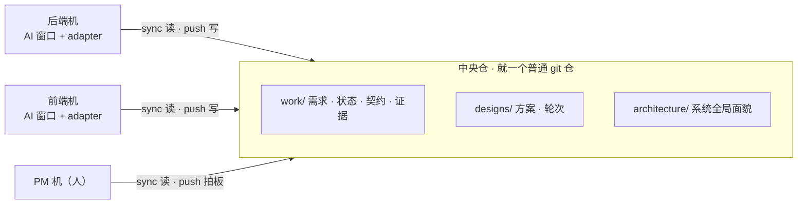
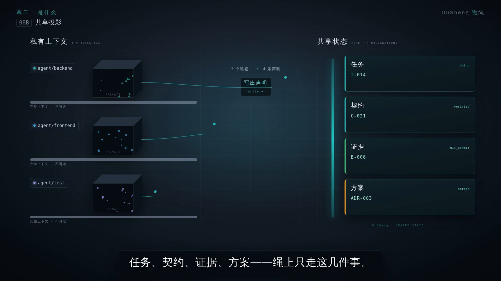

<div align="center">


# OuSheng · 㸸绳

**一根绳，一块板——把 AI 协作的状态与共识，装进一个 git 仓。**

*A git-native board for multi-agent coding: state, contracts, evidence & consensus. No server, no lock-in.*

<br/>


[](LICENSE)
[](docs/state-store.md)
[](#contributing)

**无服务器 · 无 daemon · 无数据库 · `git push/pull` 就是协作**

[网站](https://senlinpubu.top/) · [三分钟视频](https://www.bilibili.com/video/BV1Gjxn6VEwE/) · [快速上手](docs/quick-start.md) · [巡航模式](#cruise) · [路线图](#roadmap)

</div>

---

<a id="why"></a>
## 🤔 为什么需要它

AI 生成代码的速度，快过人能对齐的速度。四个老问题，一根绳全收：

| | 没有 OuSheng | 有了 OuSheng |
|---|---|---|
| **接口对不上** | 前端拿周二的文档，调周三改掉的接口 | 契约上绳，breaking 必须 human ack，全员开工即见 |
| **完成不可信** | 两边都宣称"完成了"，验收变成信不信 | C1 证据门：`git_commit` / 测试结果在代码仓硬验证 |
| **决策无据** | "当时为什么这么做"在聊天记录里 | `designs/` 方案轮次 + 拍板留痕，为什么就在仓里 |
| **夜里空转** | 无人值守 = 无人兜底 | 巡航宪章：AI 自主推进，human 门只挂起不豁免 |

人只做两件事：**拍板、看板**。

<a id="features"></a>
## ✨ 特性一览

<table>
<tr>
<td width="33%" valign="top">⚡ <b>零服务</b><br/><sub>一个普通 git 仓就是全部状态：clone 即恢复，push 即协作，无 daemon、无数据库、无注册中心</sub></td>
<td width="33%" valign="top">🚪 <b>三道写入门</b><br/><sub>证据门 C1 / 背书门 C2 / 拍板门——agent 越权写入，路径直接拒</sub></td>
<td width="33%" valign="top">🕐 <b>四个时机</b><br/><sub>上绳 / 开工 / 干活 / 收尾，定义 AI 动线；注入面最小化即提示注入免疫面最小化</sub></td>
</tr>
<tr>
<td valign="top">🧠 <b>共识层</b><br/><sub><code>designs/</code> 方案轮次讨论 + architecture 系统全貌，拍板 / supersede / 撤回全生命周期</sub></td>
<td valign="top">📄 <b>文档认领</b><br/><sub><code>doc map/check/census</code> 回答"这篇文档归谁、还作不作数"——孤儿 / 陈旧 / 膨胀三信号</sub></td>
<td valign="top">🤝 <b>上下文交接</b><br/><sub>座位级快照 <code>handover</code> ≤4KB 覆盖式单页，会话代际指针续跑；re-clone 即得</sub></td>
</tr>
<tr>
<td valign="top">🔐 <b>凭据登记</b><br/><sub>位置入册 + 本地值文件，<b>值永不入 git</b> 三重机械锁；doctor 报缺哪条，agent 自取不问人</sub></td>
<td valign="top">🌙 <b>巡航模式</b><br/><sub>宪章授权夜里自转：哨兵 / runner 两形态 + 五件套 CLI；human 门夜里只挂起不豁免</sub></td>
<td valign="top">🚢 <b>舰队部署</b><br/><sub><code>adapter install</code> 一键五件套 + <code>doctor</code> 三层自检（机器/座位/工作区），升级即重跑</sub></td>
</tr>
</table>

<a id="start"></a>
## 🚀 30 秒跑起来：把话丢给 opencode

前置：Go 1.25+、系统 `git`、[opencode](https://opencode.ai)。一个维护者加 n 个加入者，各丢各的——**命令全部由 AI 跑，你只回答问题。**

**① 发起者（项目维护者，1 人）**——在项目目录打开 opencode，丢这段话：

```
我是项目负责人，帮我把这个项目用 OuSheng（㸸绳）上绳：
0. ousheng 还没装：克隆 github.com/georgewangchn/OuSheng，go install ./cmd/ousheng。
1. 本目录立项：问我项目名，注册我（问我的名字）。
2. 问我要不要现在声明系统：我说的才注册，没说的留给各机上绳时自报——
   拓扑是长出来的，不替未来的人规划。
3. 问我要不要把仓推上 GitHub：要的话向我要 remote 地址（或用 gh 建仓）并 push。
4. 汇总：项目、我的身份、已注册系统；再告诉我怎么拉人——
   把中央仓地址发给成员，成员按 README「加入者」话术自助上绳。
```

**② 加入者（n 人：同事、PM、各机 AI 窗口）**——拿到中央仓地址后，在自己机器丢这段话：

```
我要加入一个已用 OuSheng（㸸绳）上绳的项目：
0. ousheng 还没装：克隆 github.com/georgewangchn/OuSheng，go install ./cmd/ousheng。
1. 向我要中央仓地址，clone 到本机。
2. 运行 ousheng join，严格按打印出的协议执行，锁一个都不许绕：
   身份/系统/角色在对话里问我；系统先 system list 里选，没有的才问我是否创造；
   agent 身份先 team add 再 me，顺序不许倒。
3. 我在本机的代码仓路径问我后配好映射；plugin 按协议挂。
4. push，然后汇总：我的身份/系统/角色，下一步干什么。
```

两步完成。机器损毁就 re-clone，重丢一次加入者话术。各系统的代码仓保持独立，零侵入。日常不用记任何命令：挂上 [adapter](adapters/README.md) 的窗口，开工自动注入，收尾自动收敛。

<a id="how"></a>
## 🗺 一张图看懂



机器之间不直连。git 就是通讯总线，也是审计日志和冲突解决机制。

绳上信息两类，物理性质不同，分开放：

| | 状态（现在是什么） | 共识（我们认定什么、为什么） |
|---|---|---|
| **载体** | `work/`（含契约与证据） | `designs/` `architecture/` |
| **形态** | 结构化 YAML，强 schema | 叙述文档加最小 frontmatter |
| **变更** | 高频，单点写入 | 低频演进，多方参与成形 |
| **例子** | T-042 做到哪了、契约是否 breaking | 实时推送为什么选 SSE 不选 WebSocket |

<a id="gates"></a>
## 🚪 三道门，AI 绕不过去

| 门 | 规则 |
|---|---|
| **C1 证据门** | 契约标 `verified` 必须挂证据，`git_commit` 在代码仓硬验证 |
| **C2 背书门** | breaking 变更必须 human ack，agent 自 ack 必拒 |
| **拍板门** | 方案 `agreed` 必须 human decide，agent 自拍共识必拒 |

第四道防线在提示层：`context me` 这类自动注入面**只给指针**（topic 名、文件名清单），正文不进任何 AI 上下文——注入面最小化，提示注入的免疫面就最小化。`designs/`、`architecture/` 的正文对 AI 是数据，不是指令。

<a id="state"></a>
## 📦 两页有界状态，治上下文膨胀

| 机制 | 是什么 | 保证 |
|---|---|---|
| **交接快照 `handover`** | 每座位（系统×actor）一页 ≤4KB 覆盖式导航态，git 历史=版本链 | `session` 指针续同代（`opencode run -s` 省上下文重构），不带即换代；re-clone 后 pull 即得全部快照 |
| **凭据登记 `credentials`** | 位置入册（登记表入 git）+ 值在本地 gitignored `secrets/`（0600） | **值永不入 git**——doctor 三重机械锁：被跟踪即 FAIL / 高置信形态 WARN / 缺值 FAIL 带清单。忘密码不再问人 |

> 威胁模型一句话：值不经过网络与 git，只在座位机本地文件；本机入侵归机器管理员管。

四个时机，定义 AI 的动线：

| 时机 | 谁动 | 回答的问题 |
|---|---|---|
| **零 · 上绳** | 新机（human 问答，agent 代跑） | 我是谁？做什么系统、什么角色？ |
| **一 · 开工** | AI 窗口（adapter 自动注入） | 干什么？被谁阻塞？哪个方案等我表态？ |
| **二 · 干活** | AI 窗口 | 干到哪？凭什么说做完？ |
| **三 · 收尾** | AI 窗口加人（converge 提醒） | 全局差什么？谁卡住？谁在未拍板的方案上跑？ |

<a id="cruise"></a>
## 🌙 巡航模式：夜里没人，绳自己转

白天人拍板，夜里绳自转。宪章（一张 design 卡）定义授权范围、投票规则与红线，AI 按它无人值守推进。三种驱动形态，按活分工：

| 形态 | 适合 | 机制 |
|---|---|---|
| **A · 值班哨兵** | 观测 / 巡检 / 跨系统上报 | session 内自循环（干活→sleep→sync→记 evidence）；上下文近上限即 `handover save` 自终结，不死撑 |
| **B · 外层 runner** | 实现类重活 | `cruise-loop.sh` 每轮 `cruise plan` → 干净 session → 收尾 save+sync；三闸硬顶（时窗 / 轮顶 / idle 指数退避） |
| **dispatch** | 单机多座位 | 一次 pull → 全座位活况 → 有活输出派单，等外部 runner 消费 |

五件套全是纯 CLI（零 LLM），探测与断言不靠模型自觉：

```
$ ousheng cruise plan --actor mlake --wait 600    # 下一活，无活阻塞等（活到即醒）
cruise plan · actor=mlake（优先序：恢复>领活>反应>新提）
PM away（自 22:56）——away：遇 human 门挂起转下一活；问题攒批（单内 evidence Q:，晨间批量）；不空等不空转
attach: ses_a1（续同代省上下文重构：opencode run -s ses_a1 …）

$ ousheng cruise status      # 晨间简报：宪章态 / 空转嫌疑 / 挂起三类
$ ousheng cruise report      # 结构化晨报（cron 5 7 * * *，机制保证触发）
$ ousheng cruise heartbeat   # 各座位心跳，超阈值 ⚠ 疑似停止
$ ousheng cruise dispatch    # 单机调度器（指挥官，不代跑）
```

四条铁律，夜里也不破：**无活即停**（为跑而造活是病）· **human 门不豁免**（C2/拍板夜里只挂起——挂起是巡航的正确终局）· **自提单只许 task/bug/test/notice**（feature/requirement 是 human 门）· **问题攒批**（晨间驾驶舱批量回）。模型路由按活分档计费：`OC_MODEL_WAIT` 值守轻活 / `OC_MODEL_CODE` 编码强活。

> 深入：[巡航模式设计方案](docs/OuSheng_巡航模式设计方案.md) · [双模式操作手册](docs/双模式操作手册.md)

<a id="day"></a>
## 📅 一个项目的一天（真实输出）

场景：`datax-server`（后端，同事的 AI 窗口）× `datax-ui`（前端，你的 AI 窗口）。今天的大需求：换 agent 运行引擎，编排接口大改，前端全受影响。

### 第一幕 · 状态：接口不再靠缘分

① 后端 AI 接单开工，把新接口写成契约，当即被拦下——破坏性变更没有人工确认，看板拒绝写入：

```
$ ousheng todo "运行引擎切换：pi-agent-core 替换 deepagents" --system datax-server
created T-042 (revision 1)

$ ousheng work update T-042 --file swap.yaml --expect 1
contract.breaking=true requires human_ack with non-empty approver
```

② 你看一眼变更，拍板放行。谁在何时同意的什么，永久留痕：

```
$ ousheng work update T-042 --file swap.yaml --expect 1 --ack
updated T-042 (revision 2, status doing)     # human_ack: george @ 2026-09-10
```

③ 前端 AI 下次开工就看到了：阻塞、变更中的契约直接进它的上下文。它等事实，不猜。

④ 交付要带证据——没有 git commit 或测试结果，"完成"只是口头禅：

```
$ ousheng evidence add T-042 --type test_result --locator "test/engine_test.go::TestSwap"
```

### 第二幕 · 共识：方案不再靠记性

第二天更大的需求：结果页实时推送，SSE 还是 WebSocket？PM 建单起草方案，相关窗口自动被点名：

```
$ ousheng context me --actor ui-dev
{
  "pending_reviews": ["live-results"],       ← 有个方案在等我表态
  "knowledge": ["datax-server", "datax-ui"]  ← 全局系统文档，存在即索引
}

$ ousheng design decide live-results --actor pm
design live-results decided by pm
```

agent 自己 decide，写入路径直接拒；方案 draft 就抢跑，converge 曝光；方案推翻，`supersede` 必须指认继任者，知识不断链。

你全程只做了两件事：**拍板两次，看板一眼。**

```
$ ousheng view kanban
== DOING (2) ==
[T-001] 首页改版
  System    datax-ui (湖仓前端)
  Actor     george
  Priority  P1
[T-002] 发布接口
  System    datax-server
  Blocker   T-001            ← 卡在谁那里，一眼看到

$ ousheng converge
IN_PROGRESS
```

<a id="vs"></a>
## 🆚 和常见方案的区别

| 常见方案 | 它解决什么 | 与 OuSheng 的差别 |
|---|---|---|
| Jira / Linear / 飞书项目 | 人的流程与看板 | 要服务器、要人维护；OuSheng 是给 AI 窗口读的 git 仓，零服务 |
| Wiki / Notion / 接口文档平台 | 知识沉淀 | 人工快照追不上 AI 日更；OuSheng 是开工必读的活状态，写路径有门 |
| 单机 AI agent（Claude Code / Codex） | 一个窗口的能力 | 窗口之间的事没人管：跨机对齐、契约治理、共识拍板，是 OuSheng 的范围 |
| 多 agent 编排框架（AutoGen / CrewAI） | 编排 agent 干活 | OuSheng 不编排，只给方向与信任边界。**绳不是牛** |

<a id="proof"></a>
## 🧪 工程实证

| 实证 | 内容 |
|---|---|
| **多机 dogfood** | 4 套剧本：四机全流程、混沌两辑（24 个突发：冒用身份、机器损毁、依赖环、假证据、批量雪崩）、共识层轮次 |
| **巡航实弹** | 首次通宵无人值守实栈：18:30–06:30 四域 383 条 activity 全夜无死区，PM 00:00 后纯离线；实弹复盘驱动评审修复全落地 |
| **索引一致性** | memory 与 sqlite 查询结果深度相等（S5 等价测试硬约束）；SQLite 只是可重建的派生索引 |
| **依赖白名单** | `yaml.v3`、纯 Go `sqlite`、MCP SDK；不用 JSON Schema 库，不用 go-git |
| **写入安全** | Git + YAML 唯一事实源；CAS revision 防并发写丢；strict decode 拒收手改，git 审计兜底 |

<details>
<summary><b>没有 opencode？终端五条（等价路径）</b></summary>

```bash
git clone https://github.com/georgewangchn/OuSheng.git && cd OuSheng
go install ./cmd/ousheng        # 装到 $(go env GOPATH)/bin，确认它在 PATH 里

mkdir myproj && cd myproj
ousheng setup                  # 交互式：项目名 / 你的名字 / 系统列表
ousheng todo "第一个任务"        # 自动 ID + 全默认值
ousheng view kanban
```

</details>

<a id="roadmap"></a>
## 🗺 路线图

只做被真实使用证明的事，判据驱动（全部裁决与判据见[设计裁决档案](docs/设计裁决与推演记录.md)）：

| 方向 | 状态 |
|---|---|
| 环境与版本维度（dev/uat/gray/canary/show/pro 数据化） | 判据：第一个非 dev 环境真实建立 |
| web 面板增强（PM 观测面 + 巡航驾驶舱） | 已上线基础版（`/cruise` 驾驶舱），按 PM 实用反馈迭代 |
| 模型路由实证化（值守/收敛档按实栈收敛率选型） | 判据：多夜路由对比数据积累 |
| MCP 工具面扩展（非 opencode harness） | 判据：其他 harness 真实接入 |
| credentials CLI 写面 / env 字段 | 判据：第二项目上绳或手改出错实证 |
| Go module 全路径 + release tag（`go install @latest` 一行化） | 判据：对外发布节奏启动 |

<a id="contributing"></a>
## 🤝 参与贡献

Issue / PR 欢迎。这个仓自己用 OuSheng 的纪律开发：改动前读 [AGENTS.md](AGENTS.md)（行为铁律）与[设计裁决档案](docs/设计裁决与推演记录.md)（每条规则的理由与事故背书）；每个机制都有测试锁，`go test ./... && go vet ./...` 全绿是合并底线。

<a id="docs"></a>
## 📚 文档

| | |
|---|---|
| [快速上手](docs/quick-start.md) | 日常循环 / 多人 / 多仓拓扑 / 通讯模型 |
| [多机多窗口使用指南](docs/多机多窗口使用指南.md) | 两段式上绳（join 时机零）、完整拓扑与日常协议 |
| [巡航模式设计方案](docs/OuSheng_巡航模式设计方案.md) · [双模式操作手册](docs/双模式操作手册.md) | 无人值守的授权语义 / 哨兵与 runner 实操 |
| [共识层设计方案 v0.4](docs/OuSheng_共识层设计方案_v0.4.md) | 方案讨论 / 轮次 / 拍板 / architecture 全局面貌 |
| [工程模型](docs/engineering-model.md) · [上下文协议](docs/context-protocol.md) · [存储约定](docs/state-store.md) | v0.3 规格 |
| [设计基石](docs/多人AI协作机制_方案基石.md) · [完整设计方案](docs/OuSheng_工程本体化改造方案_v0.3.md) | 为什么这样设计 |

---

<div align="center">

[](https://www.bilibili.com/video/BV1Gjxn6VEwE/)

*《OuSheng · 三次穿越》（3'26"，1080p）——从"两边都宣称完成了"到证据、契约、拍板全上绳。仓内另有 [720p 版](assets/promo/ousheng-promo-720p.mp4)可下载。*

<br/>

**一根绳，一块板。接口不再靠缘分，共识不再靠记性，夜里没人绳自己转。**

[网站](https://senlinpubu.top/) · [B 站](https://www.bilibili.com/video/BV1Gjxn6VEwE/) · [GitHub](https://github.com/georgewangchn/OuSheng) · MIT License

</div>
